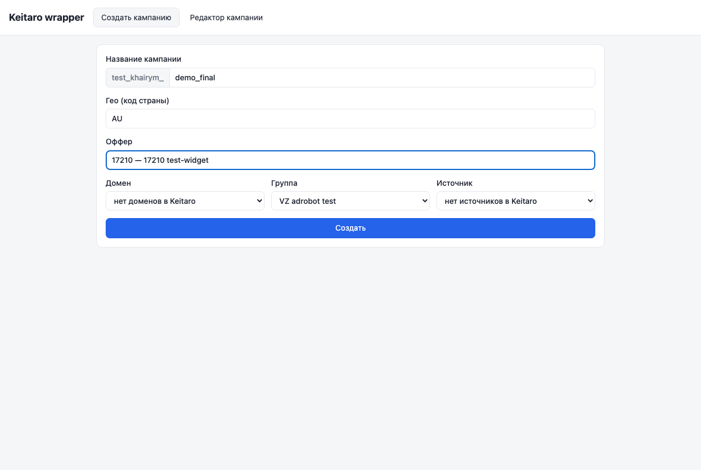
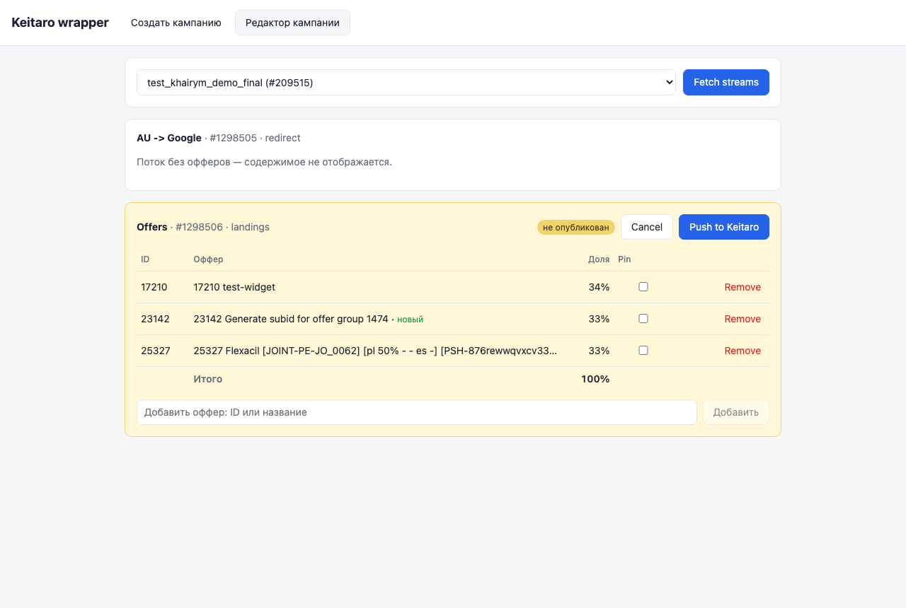
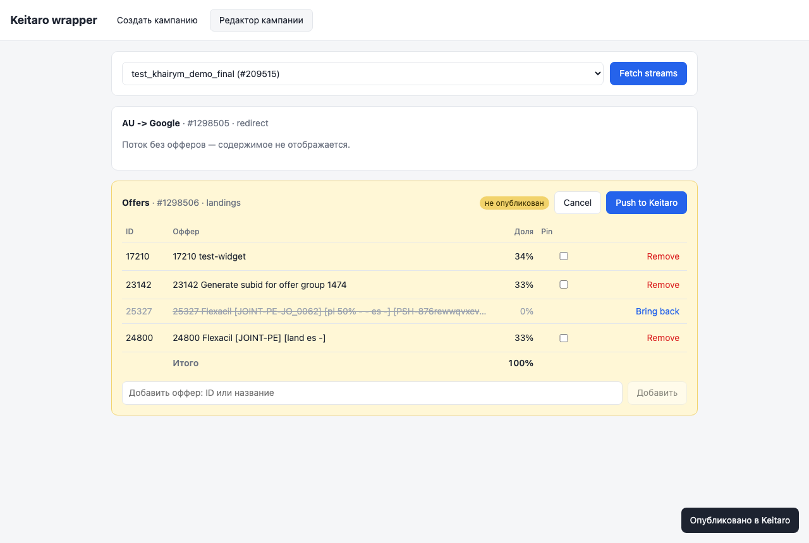
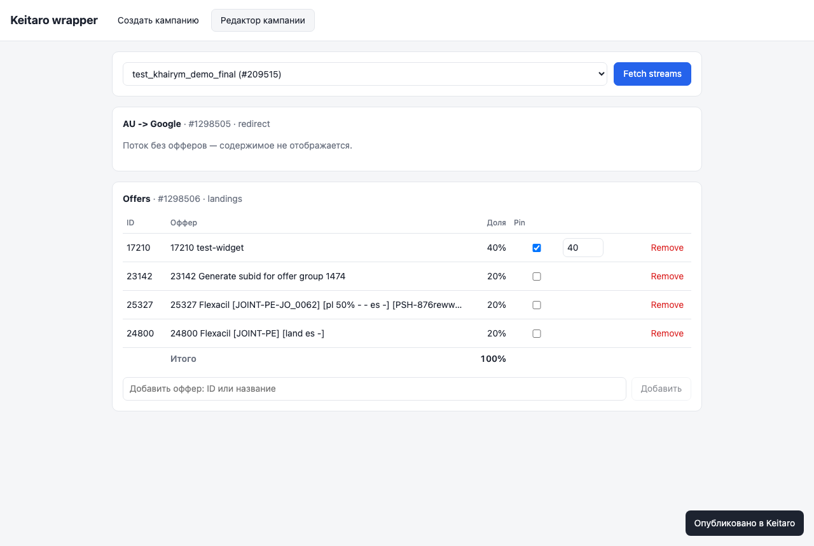
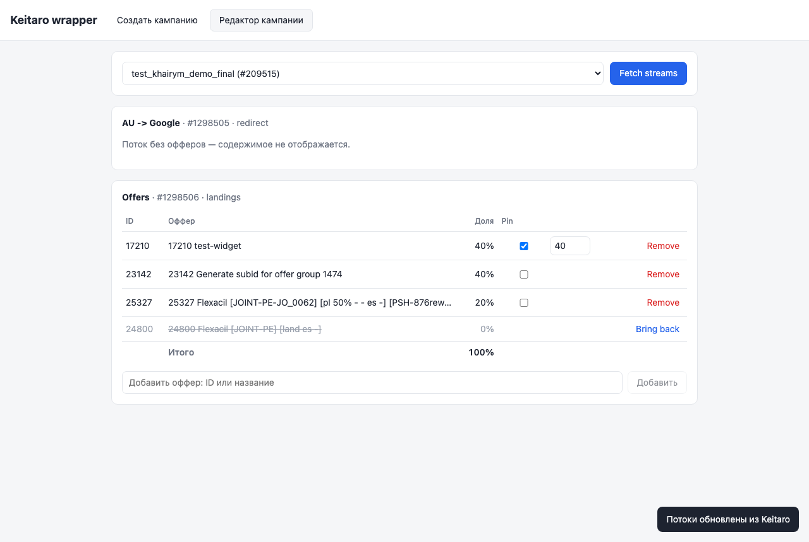

# Keitaro wrapper

Обёртка над рекламным трекером Keitaro: **создаватор кампаний** и **редактор офферов в потоках**.
Стек: FastAPI + SQLAlchemy 2 + Alembic, фронт — HTML + vanilla JS (без сборки).

## Скриншоты

| | |
|---|---|
| **Создание кампании** — префикс подставляется из `.env`, поиск оффера по ID/названию |  |
| **Добавили 2 оффера** — доли 34/33/33, поток жёлтый (не опубликован), Cancel / Push |  |
| **Remove** — оффер серый, 0%, остальные пересчитаны; Bring back |  |
| **Pin 40%** — остальные делят 60% поровну; опубликовано в Keitaro |  |
| **Оффер удалили прямо в Keitaro** → после Fetch streams он в архиве |  |

## Запуск

Нужен Python 3.9+.

```bash
python3 -m venv .venv
source .venv/bin/activate
pip install -r requirements.txt

cp .env.example .env        # и впишите KEITARO_API_KEY и свой CAMPAIGN_PREFIX
alembic upgrade head        # создаёт таблицы (по умолчанию SQLite: ./app.db)
uvicorn app.main:app --reload
```

Откройте http://localhost:8000 — интерфейс. Swagger: http://localhost:8000/docs

### Переменные окружения (`.env`)

| Переменная | Пример | Описание |
|---|---|---|
| `KEITARO_URL` | `https://tlgk.host` | адрес Keitaro (API: `/admin_api/v1`) |
| `KEITARO_API_KEY` | — | ключ из админки Keitaro |
| `CAMPAIGN_PREFIX` | `test_ivanov_` | префикс, который добавляется к названиям кампаний |
| `DATABASE_URL` | `sqlite:///./app.db` | любая БД, поддерживаемая SQLAlchemy, например `postgresql+psycopg://...` |

### Миграции

```bash
alembic upgrade head                              # применить
alembic downgrade -1                              # откатить последнюю
alembic revision --autogenerate -m "описание"     # новая миграция после правки app/models.py
```

### Тесты

```bash
pytest
```

Тесты не ходят в Keitaro — используют фейковый клиент в памяти (`tests/test_editor.py`).

## Что умеет

### 1. Создаватор кампаний

Форма принимает название, гео (ISO-код страны, например `AU`) и оффер (поиск по ID или названию),
а также домен, группу и источник трафика — выпадающие списки подтягиваются из Keitaro API.

Создаётся кампания `<CAMPAIGN_PREFIX><название>` с двумя потоками:

1. `AU -> Google` — фильтр `country = AU`, редирект на `https://google.com`;
2. `Offers` — все остальные, отправляются на выбранный оффер (100%).

### 2. Редактор кампании

Воспроизводит логику из видео в ТЗ:

- **Fetch streams** — подтягивает потоки и офферы из Keitaro. Потоки без офферов показываются просто как поток,
  их содержимое не разбирается.
- **Добавить оффер** — поиск по офферам Keitaro, доли пересчитываются поровну (3 оффера → 34/33/33, 4 → по 25%).
  Поток становится **жёлтым** — изменения ещё не опубликованы.
- **Push to Keitaro** — отправляет офферы и доли в Keitaro.
- **Cancel** — сбрасывает неопубликованные изменения: добавленные офферы удаляются, доли и закрепления
  возвращаются к последней публикации.
- **Remove** — оффер сереет, доля 0%. После Push он пропадает из Keitaro, но остаётся в обёртке в архиве.
- **Bring back** — возвращает оффер из архива, доли пересчитываются.
- **Удаление в самом Keitaro** — если оффер удалили в Keitaro, после Fetch streams он не исчезает,
  а попадает в архив (removed) с кнопкой Bring back.
- **Pin** — закрепляет долю оффера. При любых пересчётах закреплённые доли не меняются,
  остаток до 100% делится между незакреплёнными. Сумма закреплённых > 100% и Push с суммой ≠ 100% запрещены.

Доли в Keitaro — целые числа, поэтому остаток от деления раздаётся по 1% первым офферам, и сумма всегда ровно 100%.

## Устройство

```
app/
  main.py       FastAPI: роуты API и отдача фронта
  services.py   бизнес-логика: создание, синхронизация, редактор, push/cancel
  weights.py    пересчёт долей с учётом закреплённых
  keitaro.py    клиент Keitaro Admin API (httpx), кэш списка офферов на 5 минут
  models.py     Campaign → Stream → StreamOffer
  static/       index.html, app.js, style.css
migrations/     Alembic
tests/          pytest
```

Состояние оффера в потоке (`stream_offers`):

| Поле | Смысл |
|---|---|
| `status` | `active` или `removed` (архив) |
| `is_new` | добавлен в обёртке и ещё не опубликован — Cancel удаляет такие |
| `pinned` | доля закреплена (хранится только в обёртке) |
| `pinned_published` | закрепление на момент последнего Push — к нему возвращают Cancel и Fetch |
| `share` | доля в процентах |

`streams.dirty = true` — в потоке есть неопубликованные изменения (жёлтый поток).

## Замечания

- В тестовом аккаунте Keitaro не было ни доменов, ни источников трафика (API возвращает пустые списки),
  поэтому эти поля в форме необязательные: когда они появятся в Keitaro, они появятся и в выпадающих списках.
- Keitaro требует `alias` кампании — он генерируется из названия с коротким случайным суффиксом.
- Fetch streams сбрасывает неопубликованные изменения (интерфейс предупреждает об этом).
